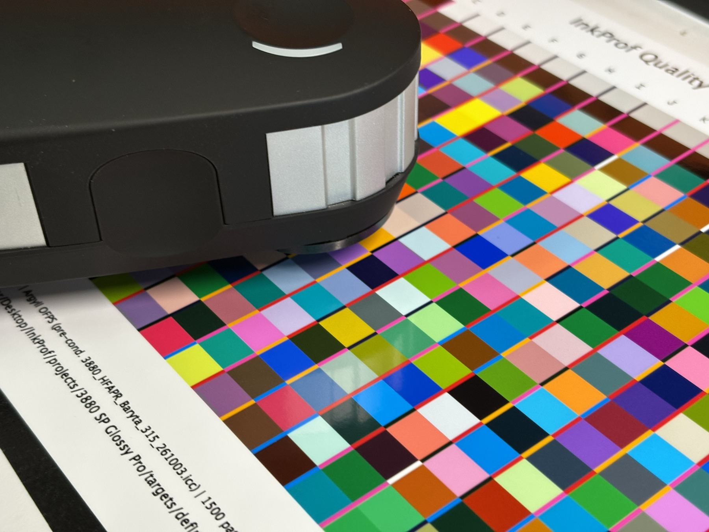

# InkProf v1.1.0 — stable source release

**Keep your i1Pro 2. Take control of your prints.**

Find out what your printer, paper and ink can reproduce. Build a profile, check the result and give your client measured evidence of what you deliver.

InkProf is an open-source MATLAB app for RGB printer profiling and verification. It communicates with the i1Pro 2 through ArgyllCMS, independently of i1Profiler. The workflow is tested with the i1Pro 2 on macOS.



*Spectral measurement of a printed target: the basis for profiling and verification.*

## What you gain

- **Keep using your existing instrument.** ArgyllCMS handles instrument communication, so your profiling workflow is independent of i1Profiler.
- **Make better-informed image and paper choices.** An ICC profile describes your printing setup and supports soft proofing. A separate print and measurement checks the physical result.
- **Reduce unnecessary test prints.** Saved settings, measurements and revisions help you repeat a working process and investigate changes. This can save time, paper and ink.
- **Make quality clear to your client.** The certificate records reference colours, measurements, scope and reviewer decisions. The detailed measurement appendix retains the evidence.

Each project preserves its inputs, profiles, checks and history. You can close it while prints dry and resume later. RGB printers receive RGB data through their driver; most inkjet photo printers use this workflow. InkProf saves TIFF16 targets for separate printing and performs measurement in the app.

Version **1.1.0** adds **inner gamut shell refinement**: place additional measured colours near the gamut surface, across the whole shell or selected areas, and review the proposal before printing. Image colours, verification errors, manual areas and ICC-grid trials share the same refinement tools. The app suggests the next valid workflow step.

## Availability and requirements

InkProf is **free to download** under GPL version 3 or later. **MATLAB requires a licence**; base MATLAB is sufficient. Python, ArgyllCMS and a compatible spectrophotometer are installed separately. The complete workflow is tested on **macOS with the i1Pro 2**; Windows/Linux and all instrument modes are not qualified.

[Download the stable v1.1.0 source release](https://github.com/chto0703009/InkProf-public/releases/tag/v1.1.0) · [Swedish overview](README.sv.md) · [English benefit presentation](docs/usage/InkProf-presentation-English.pdf) · [English user handbook](docs/usage/InkProf-user-handbook-English.pdf)

The source release was published **2026-10-12**. Handbooks and presentations in this repository were revised **2026-10-13**; attached release assets preserve the original publication snapshot. See [release notes](docs/releases/v1.1.0.md) and [validation](VALIDATION.txt).

Print accuracy depends on the printer, paper, ink and settings. Numerical checks and screen previews do not replace physical verification. Certificates document evidence and decisions; they are not accredited certification or a declaration of full ISO conformity.

## Install and start

This is a **source release**, not a standalone executable. Install MATLAB, Python and ArgyllCMS separately.

- Tested on macOS with MATLAB R2025b (base MATLAB; no mandatory add-on toolboxes).
- Python 3.10 or later for measurement (the startup check requires at least 3.10); 3.11–3.13 for analysis and reports (`requirements-analysis.txt`, `requirements-report.txt`); tested with 3.13.
- ArgyllCMS 3.5.0 was used in development. InkProf discovers Homebrew installations on Apple Silicon and Intel, including when MATLAB is launched without Homebrew on PATH. An explicit local override remains available; `setupInkProf(ArgyllBin="auto")` resets it. Automatic discovery is not saved as a fixed machine path.
- Instrument measurement uses a POSIX bridge. Windows instrument operation has not been qualified.
- The project app uses English labels, dialogs and workflow guidance. Matching Swedish and English user handbooks are included.

Clone the stable source release:

```sh
git clone --branch v1.1.0 https://github.com/chto0703009/InkProf-public.git
cd InkProf-public
python3 -m venv .venv
.venv/bin/python -m pip install -r requirements-report.txt
```

From the repository folder in MATLAB:

```matlab
paths = setupInkProf(CheckPython=true);
% If needed: setupInkProf(ArgyllBin="/path/to/Argyll/bin",CheckPython=true);
startInkProfApp();
```

Choose **New project** or **Open project**. Create your own RGB target or import a definition you are entitled to use. Print the saved TIFF16 separately and use its matching target data for measurement. The app does not print, install profiles automatically or certify ISO conformity.

## Verify an existing printer profile

Choose **New project → Verify existing ICC** for a separate seven-step workflow. The editable 575-patch suggestion uses a balanced photographic selection, including neutrals, skin tones, shadows, difficult colours and repeats. Print, measure and document the result without rebuilding the imported profile. See [existing ICC verification](docs/usage/verify-existing-icc.md).

## Documentation

The user handbook is maintained in matching Swedish and English editions. App labels remain English. See the [v1.1.0 release notes](docs/releases/v1.1.0.md) for the current changes.

- [Swedish user handbook (PDF)](docs/usage/InkProf-anvandarhandbok-svenska.pdf)
- [English user handbook (PDF)](docs/usage/InkProf-user-handbook-English.pdf)

- [Swedish presentation (PDF)](docs/usage/InkProf-presentation-svenska.pdf)
- [English presentation (PDF)](docs/usage/InkProf-presentation-English.pdf)
- [English profiling workflow and MATLAB guide (PDF)](docs/usage/InkProf-profiling-workflow-MATLAB-guide-English.pdf)
- [Release notes](CHANGELOG.md), [release checklist](docs/releases/v1.1.0.md) and [public release scope](RELEASE_SCOPE.md)

The guides describe callable operations as well as the project workflow. Historical research notes may refer to private experiments or fixtures that are not part of this public release. The release notes and this README take precedence for installation and current scope.

## Project details and portability

**New project** collects the project name, user, printer, paper, Glossy/Matte surface, ink set, driver/RIP, media setting, print quality, printing application, colour management, drying time and additional settings. **Project details** edits the same shared definition later. B1, B2, C3 and final reports use this definition; printing fields in B2 are read-only.

Renaming a project also renames its folder, while retaining its ID, relative references and original evidence. Existing destination folders are never overwritten. When a folder was renamed outside InkProf, opening it prompts you to adopt the folder name as the project name, restore the saved folder name, or cancel. Decisions (including cancellation and failure) are recorded in `folderNameHistory`, workflow JSON and the result log. Moving to a different parent directory or computer with the same folder name does not trigger this prompt. Changed physical printing declarations invalidate B1 and subsequent profiling stages; measurements are preserved. Changing only FWA/OBA compensation preserves B1 and invalidates B2 and later profile results. Name/user corrections require a new final report. Historical files and change logs are retained.

To move between computers, finish active operations, close the project and copy the **entire project folder**, including hidden files. Open it on the destination computer with **Open project**. The app verifies registered files against SHA-256 checksums before opening; **Verify project** repeats the read-only check. Missing/changed files or active lock files block opening. Install InkProf, MATLAB, Python dependencies and ArgyllCMS separately on the destination and configure local runtime paths there. Do not copy the application `.venv` or `local-config`. External exports are separate; project copies are included. Recorded drying hours are documentation, not proof that a print has dried.

## Quality and limitations

The workflow distinguishes training data, development data and independent checks. If a verification result is used to refine a profile, later final verification requires independent data. A successful profile build does not prove acceptable print quality. Physical instrument compatibility, repeatability, paper, drying and print settings must be checked for the actual setup. Basic measurement has been tried with an i1Pro 2; all device modes and platforms are not qualified.

## Tests

```sh
.venv/bin/python -m unittest discover -s tests -p 'test_*.py'
.venv/bin/python tools/check_license_inventory.py
```

In MATLAB, after setup:

```matlab
setenv('INKPROF_TEST_PYTHON',char(paths.PythonExecutable));
r = runtests('tests');
assertSuccess(r);
```

Tests depending on excluded third-party reference material are not shipped. The remaining suite uses generated or synthetic inputs. Automated tests are not a substitute for instrument and print qualification.

## Licence and attribution

Copyright (c) 2026 Christer Törnkvist. InkProf's own code and documentation are **GNU GPL version 3 or later** (`GPL-3.0-or-later`). See [LICENSE](LICENSE), [THIRD_PARTY_NOTICES.md](THIRD_PARTY_NOTICES.md) and [licenses/](licenses/).

Third-party resources keep their own licences. ArgyllCMS is installed separately; the reviewed 3.5.0 tools report AGPLv3. MATLAB is proprietary and requires a separate licence. No MATLAB, Python or Argyll runtime is bundled. The unmodified CxF3 schema carries its own included licence. Other product names are descriptive; InkProf is not endorsed by their vendors.

### Warranty and responsibility

InkProf is provided as is, without warranties. Users are responsible for checking measurements, ICC profiles and print results before use. To the extent permitted by applicable law, the copyright holder is not liable for damage or loss arising from use. See GNU GPL v3, sections 15–17. This summary does not replace the licence.


 Report reproducible issues through [GitHub Issues](https://github.com/chto0703009/InkProf-public/issues), removing private measurements and personal data first.

Maintainer: Christer Törnkvist - christer@borgasundsfotografiska.se

## FWA/OBA compensation and rotating HTML reports

**Project details → Project and materials → Compensate optical brighteners (D50)** enables optional Argyll FWA compensation. It can be changed after profiling: original measurements and previous profiles remain, while profiling and validation must be repeated. Native M0 spectra, a known non-UV-filtered instrument and measured paper white are required. The option, processing settings and edits are recorded in JSON and reports. See [FWA/OBA guide](docs/usage/optical-brighteners.md).

The HTML final report automatically rotates the predicted CIELAB control colours offline. These points are not measured data or the full printer gamut. PDF and printing retain a still image; reduced-motion browser preferences are respected.

## Measurement certificate

The final profiling report is now a **measurement certificate** with project and printing details, the limits of printer/paper/ink reproduction, and a dated page for handwritten signature. It states the customer's responsibility when the customer prints the targets or supplies project information, subject to mandatory law and the provider's own responsibilities. See [certificate documentation](docs/usage/measurement-certificate.md).

## Current project settings and refinement

Project details is the single source for printer, paper finish, dye/pigment ink type, printer coating, drying time, profiling settings and paper/sled dimensions. Matte paper can use additional shadow sampling: by default up to 48 extra dark fitting patches per iteration (editable, 0–256), editable dark emphasis and denser shadow tables. See [matte shadows](docs/usage/matte-shadow-profiling.md).

Image-guided refinement honours the embedded ICC; missing profiles trigger an sRGB warning. Candidate filtering defaults to estimated ΔE00 > 5. Unmeasured C2 patches can join the refinement target and are then used as fitting data for the next profile, with controls retained. They no longer constitute independent verification of that next profile.

The current app has 19 workflow rows. [Start with the complete workflow guide](docs/usage/workflow-v1.0.md). Step 14 delivers a print-reviewed profile and certificate; step 19 delivers a numerically checked later iteration with the lack of separate print verification stated explicitly. HTML exports are self-contained folders with supporting files.

### Apple Silicon SciPy installation troubleshooting

Post-release source update (2026-10-11): full Python setup checks now test actual package imports and compiled SciPy modules. A broken import stops analysis with repair instructions for the selected environment. New source installations use SciPy 1.16.3 after a reported M4/Python 3.13 import failure with SciPy 1.15.3. See [Python runtime troubleshooting](docs/usage/python-runtime.md#scipy-compiled-library-failure-on-apple-silicon). The original v1.0.0 release archive is unchanged.
